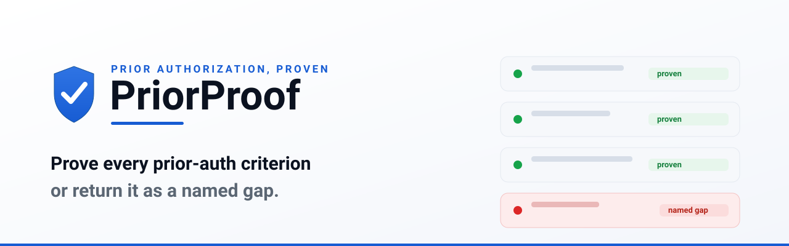
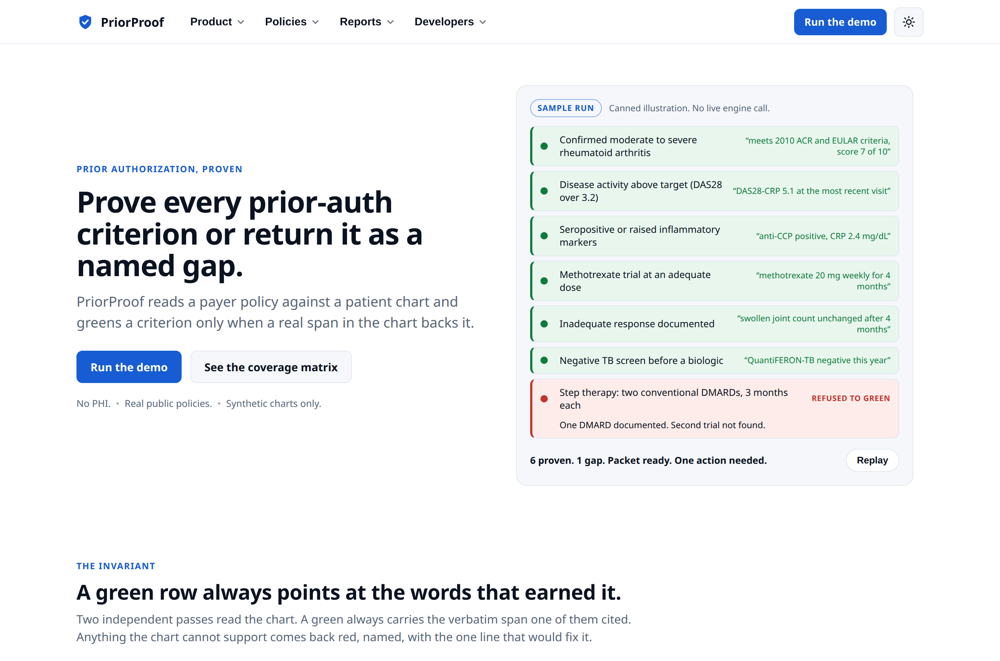
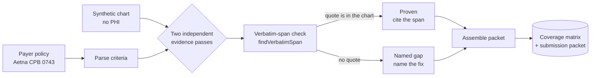
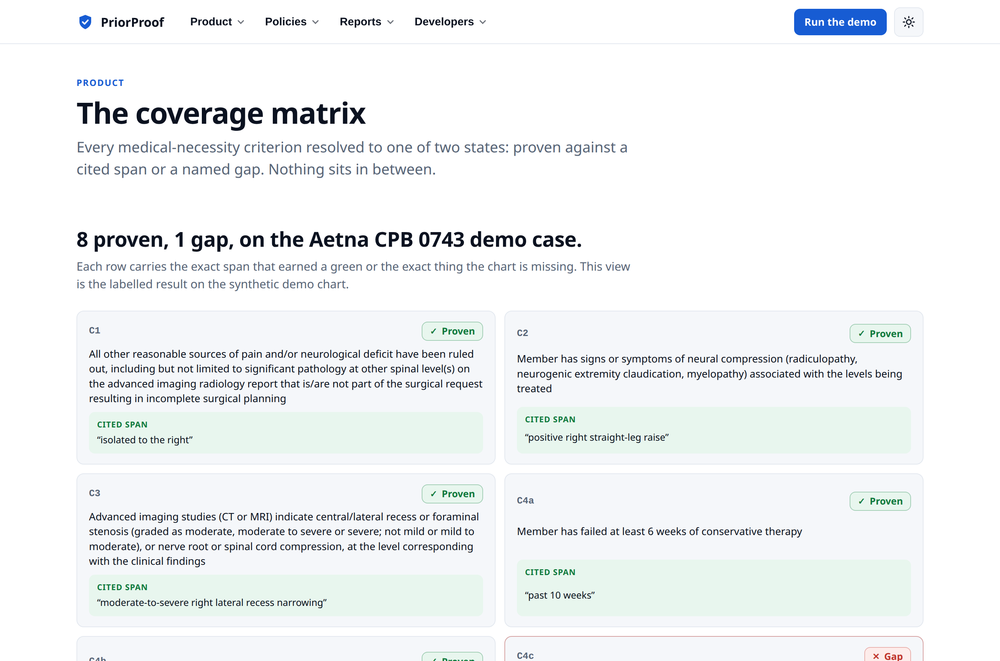
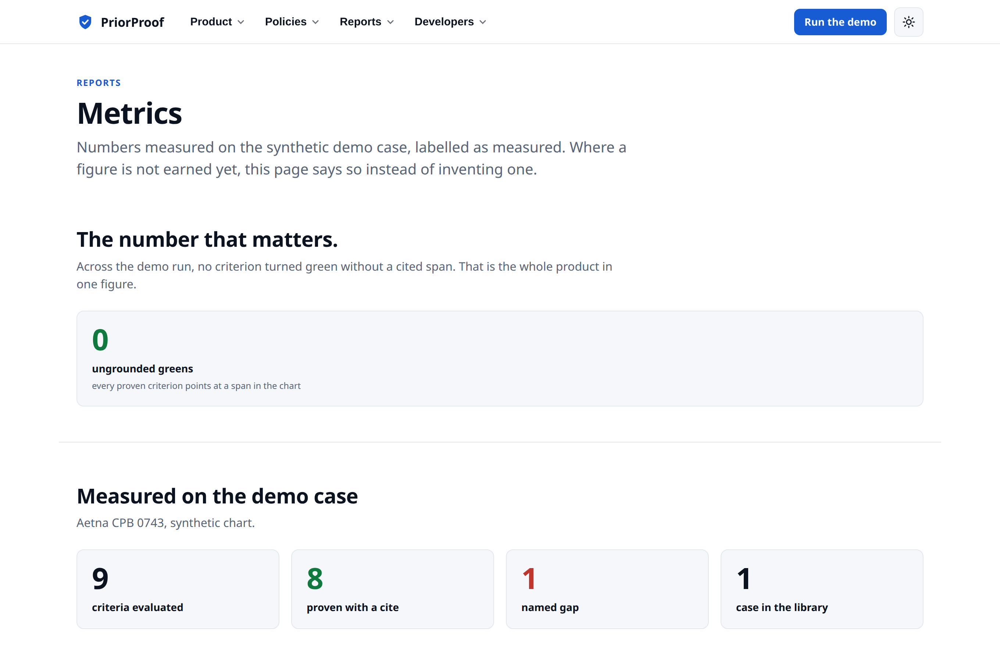
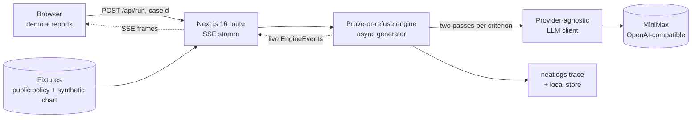

<!-- SPDX-License-Identifier: LicenseRef-zkasuran-SAND-1.0 -->
<p align="center">
  <picture>
    <source media="(prefers-color-scheme: dark)" srcset="docs/assets/banner-dark.svg">
    
  </picture>
</p>

<p align="center">
  <a href="https://priorproof.vercel.app"><b>Live demo</b></a> &middot;
  <a href="#try-it-in-60-seconds">Try it</a> &middot;
  <a href="#how-it-works">How it works</a> &middot;
  <a href="SECURITY.md">Security</a> &middot;
  <a href="#licence">Licence</a>
</p>

<p align="center">
  
  
  
  
  
</p>

---

**PriorProof is a prove-or-refuse prior-authorization agent.** It reads a real public payer medical-necessity policy against a patient chart, then returns a submission-ready packet and a coverage matrix where every criterion is either proven against a verbatim span quoted from the chart or returned as a named gap. On the demo case that means **0 ungrounded greens**: every green row points at the exact words that earned it. The one criterion the chart cannot support stays red.

> **Why now.** Over 80 percent of appealed Medicare Advantage prior-auth denials are overturned, yet only about 10 percent of denials are ever appealed. [KFF, 2022 data] A cited, submission-ready packet turns the appeal that usually wins into a routine step.

<p align="center">
  <picture>
    <source media="(prefers-color-scheme: dark)" srcset="docs/assets/hero-dark.png">
    
  </picture>
</p>

## Try it in 60 seconds

Open **[priorproof.vercel.app](https://priorproof.vercel.app)**, then go to the live demo. Each run calls a hosted model, so give it a few seconds.

| | Do this | You will see |
|---|---|---|
| 1 | Open **[/demo](https://priorproof.vercel.app/demo)** and pick the policy (Aetna CPB 0743, 9 criteria) | The synthetic no-PHI chart loads with its one built-in gap |
| 2 | Press **Run** | Two independent passes stream and the coverage matrix fills row by row while Proven, Gaps, Resolved and Elapsed update live |
| 3 | Watch **C4c** | It stays red as a named gap, active in-person physical therapy, with the one line that would close it |
| 4 | Press **Build packet** | A submission-ready packet with the eight cited criteria and the one gap, marked action-needed until the gap is filled |

## How it works



1. **Parse.** The payer policy is decomposed into medical-necessity criteria, nine for the demo case, each tagged with its policy source.
2. **Read twice.** Two independent passes look for a chart span that supports each criterion. Both passes are kept in the audit trail, so the second read is visible, not decorative.
3. **Check the quote.** Every cited span is checked against the chart by `findVerbatimSpan`, a plain substring match then a whitespace-collapsed match mapped back to the exact chart slice. A quote that is not present forces that pass to not-found.
4. **Prove or refuse.** A criterion is proven when at least one pass cites a verbatim span. When neither can, it is a named gap carrying the one line that closes it. There is no third approving verdict, so the packet is marked action-needed while any gap remains.

<table>
  <tr>
    <td width="50%"><picture><source media="(prefers-color-scheme: dark)" srcset="docs/assets/matrix-dark.png"></picture><p align="center"><sub><b>The coverage matrix.</b> Eight criteria proven on cited spans, C4c returned as a gap.</sub></p></td>
    <td width="50%"><picture><source media="(prefers-color-scheme: dark)" srcset="docs/assets/metrics-dark.png"></picture><p align="center"><sub><b>The number that matters.</b> 0 ungrounded greens across the demo run.</sub></p></td>
  </tr>
</table>

## The prove-or-refuse guarantee

| The agent returns | When | What the row carries |
|---|---|---|
| **Proven** (green) | at least one of two independent passes cites a span the verbatim check confirms is literally in the chart | the exact quoted chart span |
| **Gap** (red) | neither pass can cite a verbatim span that satisfies the criterion | the missing requirement plus the one line that would close it |
| no third verdict | there is deliberately no "approved" state to fall through to | the packet stays action-needed while any gap remains |

## Who it is for

| Who | Why PriorProof |
|---|---|
| Specialty practices (ortho, cardiology, radiology, oncology, gastro) | prior auth is dense and denials are costly, so a cited packet goes out complete or not at all |
| Revenue-cycle-management firms | they run prior auth for many practices at once and already carry a BAA posture |
| Medical billing companies | they hold the payer relationship and want a faster, auditable packet |

## Architecture



One engine holds the rule. The browser and any API caller drive the same async generator, so the demo and a script can never disagree about who proved what. Entire checkpoints pair each build commit with the coding-agent session that produced it, so a reviewer can trace a part of the agent back to the commit where it landed. That is a build-time record, not a runtime dependency.

## What is real and what is simulated

| Real | Simulated or labelled sample |
|---|---|
| The policy is a real public Aetna bulletin (CPB 0743), linked to its source | The patient chart is synthetic with no PHI, written for the demo |
| The engine, the two-pass loop and the verbatim-span check are the shipped code the tests cover | The home-page hero matrix is a canned scripted illustration, labelled "Sample run. No live engine call." |
| The live `/demo` runs a hosted probabilistic model (MiniMax in production) that errs toward a gap | The matrix, metrics and validation pages show the labelled fixture oracle, not a fresh model run |
| neatlogs tracing dual-writes to neatlogs when `NEATLOGS_API_KEY` is set | Without a key, tracing falls back to a local in-memory store so the trace still renders |
| Entire checkpoints pair each build commit with its coding-agent session | Resume-without-re-reading is a PriorProof app feature backed by a local store, not an Entire capability |

The output is a drafting aid on synthetic data, not a clinical decision. A clinician signs the request. Two reads of a borderline criterion can differ. The engine errs toward a gap, so the error direction is a conservative ask for clearer documentation, never a false green.

## Run it locally

```bash
git clone https://github.com/zkasuran/priorproof && cd priorproof
pnpm install
pnpm dev                                 # http://localhost:3000
```

Set a provider key in the server environment before a run. It is read only on the server, never in a `NEXT_PUBLIC` variable, never in argv or a log.

```bash
export OPENAI_API_KEY=sk-...             # or ANTHROPIC_API_KEY
# to run on MiniMax the way production does, point the OpenAI-compatible client at it:
export OPENAI_BASE_URL=https://api.minimax.io/v1
export OPENAI_MODEL=MiniMax-M2           # any OpenAI-compatible chat model id
export NEATLOGS_API_KEY=...              # optional: without it the trace writes to a local store
```

## API quickstart

`POST /api/run` streams one run as Server-Sent Events. The body is a `caseId` that selects a server-side fixture, so there is no free-text chart or policy entry point. The server reads the model key from its own environment, never from the request.

```bash
curl -N -X POST http://localhost:3000/api/run \
  -H 'content-type: application/json' \
  -d '{"caseId":"aetna-0743-lumbar"}'
# -> run_start, criteria_parsed, then evidence and criterion_resolved frames, then packet_ready
```

## Built to be attacked

The full threat model is in **[SECURITY.md](SECURITY.md)**: one row per attacker and attack, the defence and the file that holds it.

- **Prove or refuse.** A criterion greens only on a verbatim chart span. A chart that does not support a criterion returns a named gap, since there is no approving verdict to fall through to.
- **Hallucinated citations rejected.** `findVerbatimSpan` checks every cited quote against the chart, so a quote that is not present forces that pass to not-found and cannot support a green.
- **Prompt injection cannot flip a verdict.** Text in a chart that tells the model what to decide creates no verbatim span, so it cannot turn a gap green.
- **Keys stay on the server.** Provider keys are read only from server env, never a `NEXT_PUBLIC` var, never argv, a log or a trace span.
- **Strict CSP.** A per-request nonce drives `default-src 'self'`, `script-src 'self' 'nonce' 'strict-dynamic'`, `connect-src 'self'`, `object-src 'none'`, `base-uri 'none'`, `form-action 'none'` and `frame-ancestors 'none'`, with nosniff, no-referrer, `X-Frame-Options: DENY`, HSTS and a locked Permissions-Policy on every route.
- **Bounded and escaped.** The criterion count is capped by `MAX_CRITERIA` and model and chart text render as escaped React text with no `dangerouslySetInnerHTML`. Garbled model output degrades to a gap rather than throwing.
- **Supply chain.** Every dependency is pinned and `pnpm-lock.yaml` is committed. The audit gate carries exactly two reviewed transitive exceptions, each with a written reason in `audit-allowlist.json`.

```bash
./verify.sh    # prints ALL GREEN or stops at the first failure; CI runs the same script
```

It runs install (frozen lockfile), typecheck (`tsc --noEmit`), lint (eslint), the 11 vitest tests, the production build of 19 routes, then a supply-chain audit that fails on any high or critical advisory that has a fix and is not a reviewed exception.

## Repository

```
app/                      Next.js routes: /demo, product, reports, developers, /api/run (SSE)
lib/engine/               the engine: parse, two-pass evidence, verbatim check, decide, packet
lib/llm/                  provider-agnostic client: OpenAI-compatible (MiniMax) and Anthropic adapters
lib/trace/                neatlogs dual-write with a local-store fallback
lib/fixtures/             the public policy and the synthetic no-PHI chart
components/               the coverage matrix, packet, trace rail and themed nav
__tests__/engine.test.ts  11 tests: the invariant, the mutation test, a 250-run property test
proxy.ts                  the per-request nonce CSP
verify.sh                 the one-command release gate
SECURITY.md               threat model, status and known limits
docs/BUSINESS-PLAN.md     the cfo.ai business plan
```

## Roadmap

- [x] Prove-or-refuse engine, two-pass evidence, verbatim-span check, live coverage matrix and submission packet
- [x] Aetna CPB 0743 demo case: 9 criteria, 8 proven and 1 named gap, 0 ungrounded greens
- [x] neatlogs tracing, Entire build checkpoints and a one-command `verify.sh` gate
- [ ] More public payer policies in the case library
- [ ] Free-text policy and chart input with named size ceilings (`lib/engine/limits.ts`)
- [ ] The HIPAA and BAA path for real charts, synthetic and de-identified only until then

## Licence

Source-available, no derivatives: [`LicenseRef-zkasuran-SAND-1.0`](LICENSE). You may run, read, audit and benchmark it. You may not redistribute it or build derivative works.

Built with AI assistance for neatHack, the neatlogs 48-hour AI-agent hackathon. The design, the tests and the verification are the author's.

<p align="center"><sub>PriorProof &middot; built for neatHack &middot; <b>Prove every prior-auth criterion or return it as a named gap.</b></sub></p>


